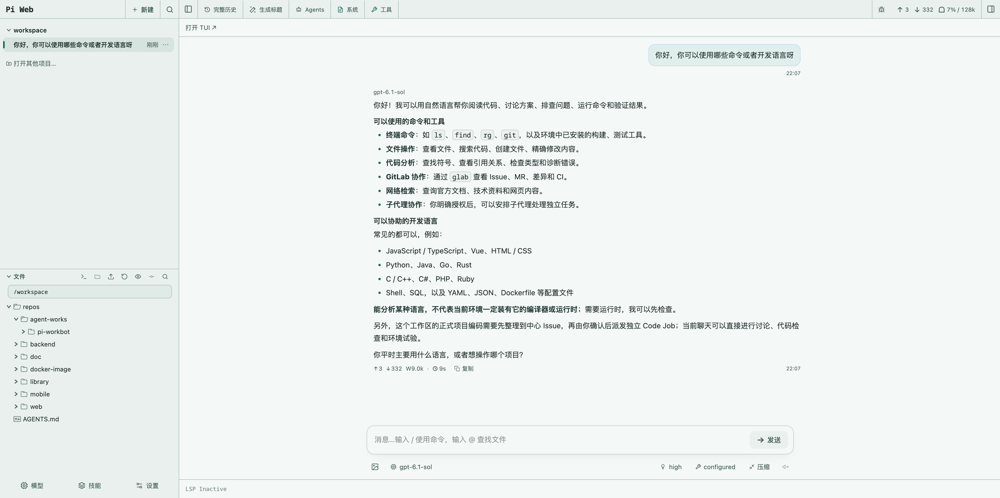
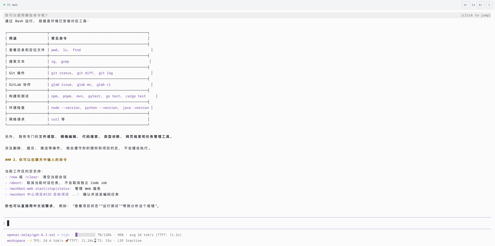
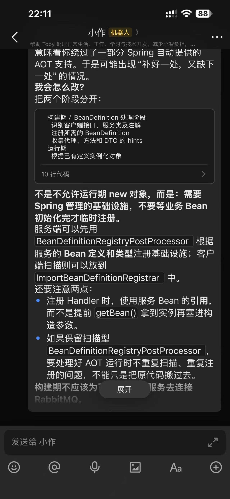
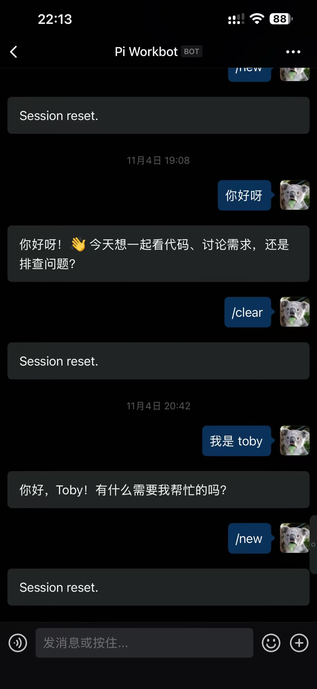

# Pi Workbot

将个人基于 Pi 的研发实践打包成标准环境，供团队成员通过飞书、企业微信或浏览器开展远程协作，通过 GitLab CI 执行编码任务，用 Issue 和 MR 保存成果。

## 使用场景与截图

### 浏览器工作区：了解环境、讨论需求与排查问题

打开 Pi Web 即可用自然语言了解可用工具、讨论方案、阅读代码或分析报错。左侧集中展示会话与工作区文件，适合不想先配置本地开发环境的同事，也方便研发人员远程 Review 和试验环境。图中展示的是首次对话：询问支持的命令与开发语言，了解当前工作区的能力和协作边界。



### 浏览器内的 Pi TUI：使用原生终端交互

偏好终端的研发人员，可以在启用 [独立 Pi TUI](docs/使用.md#独立-pi-tui) 后，从 Web 会话点击「打开 TUI ↗」，在新标签页继续使用原生 Pi。适合通过对话检查项目状态、运行测试和排查环境问题，无需在本机安装 Pi。图中展示了 TUI 的对话输出、输入区，以及底部的模型和上下文状态。



### 飞书与企业微信：在日常聊天中接入研发能力

不在电脑前，也可以通过熟悉的 IM 入口讨论需求、追问方案和排查问题，无需另开浏览器或终端。

- **飞书 · 技术方案讨论**：图中围绕 Spring AOT 与 Bean 注册时机展开分析，用分点说明和代码块呈现改进建议，适合在手机上阅读方案、继续追问实现细节。
- **企业微信 · 日常对话与会话管理**：图中展示了与机器人的自然语言交流，以及通过 `/clear`、`/new` 重置当前会话的反馈，适合切换话题时清理旧上下文，再开始新的讨论。

| 飞书：技术方案讨论                                                                                                                        | 企业微信：对话与会话管理                                                                                                      |
| ----------------------------------------------------------------------------------------------------------------------------------------- | ----------------------------------------------------------------------------------------------------------------------------- |
| [](docs/images/feishu-technical-discussion.jpg) | [](docs/images/wecom-session-management.jpg) |

截图可点击查看原图。截图中的模型、工具与界面以拍摄时的环境为例，实际能力取决于部署配置。以上入口都服务于同一套云端研发环境；团队模式的正式项目编码仍通过用户确认后的 GitLab code Job 交付。

## 快速开始

- **个人体验**：按 [独立部署](deploy/README.md) 从源码构建，配置模型端点、API Key 和 Web 密码，无需先准备 GitLab Runner。
- **团队协作**：按 [使用说明](docs/使用.md) 准备 GitLab、Runner 和运行变量，使用 Issue → code Job → MR 流程。

```sh
git clone https://github.com/naivetoby/pi-workbot.git
cd pi-workbot/deploy
cp .env.example .env
# 填写 PI_WEB_PASSWORD、OPENAI_RELAY_BASE_URL 和 OPENAI_RELAY_API_KEY。
vi .env
docker compose up -d --build --wait --wait-timeout 420
```

独立部署要求 Linux amd64、Docker Engine 和 Compose v2，首次构建耗时较长。默认只监听服务器 `127.0.0.1:30141`，远程访问使用 SSH 隧道或 HTTPS 反向代理。

**仅面向可信个人或团队，不是多租户平台。** IM 空白名单允许所有发送者，Web/终端共享工作区和凭证；接入前阅读 [安全边界](SECURITY.md)。

## 定位

让非研发同事也能直接使用 AI 研发能力，将开发环境、工具、凭证和上下文的准备集中到团队维护的工作区，支持随时访问、按需重建。

**产品本体是持续演进的云端 Pi 研发工作区，IM 是降低使用门槛的入口。** 工作区包含模型配置、插件、Skills、`AGENTS.md`、MCP、glab、工具链和脚本。维护者持续优化这套环境，逐步将更多研发工作迁到云端。

Workbot 负责环境打包、工作区初始化和协作入口；模型、工具、会话与设置由 Pi 提供，渠道和浏览器交互使用现成组件。研发能力与策略优先通过 Pi 原生配置、插件和工作约定组织。

## 未来方向与技术演进

项目的核心不是聊天机器人，而是：

> **将个人有效的 Pi 研发实践，持续沉淀成团队可使用、可试验、可重建的云端研发环境。**

对应的技术演进应当是：

| 方向                                | 适合的承载位置              |
| ----------------------------------- | --------------------------- |
| 模型、Skills、MCP、工具策略持续试验 | Pi 原生配置和插件           |
| 编译、测试、诊断能力逐步完善        | 基础镜像、角色镜像          |
| 团队访问与协作体验改善              | IM、Web、GitLab 的薄适配    |
| 试验成果成为稳定环境基线            | GitHub PR、构建、验证与回滚 |
| 长期协作记录可接续                  | GitLab 成果记录、持久化会话 |

模型切换、Web 升级、构建稳定性改善、会话持久化，都沿着这条主线演进。环境能力可以持续增长，但 Workbot 自身的复杂度应增长得更慢。

因此，当前不自建任务数据库、调度系统、配置继承框架或 Agent 抽象层，也不以多租户平台为既定目标。除非将来有明确需求，否则这些会增加维护成本，而不是帮助实现愿景。新的需求优先判断能否由 Pi 原生能力、现有组件或简短工作约定承载，再决定是否增加 Workbot 代码。

## 运行方式

| 角色   | 运行方式            | 用途                                                      |
| ------ | ------------------- | --------------------------------------------------------- |
| `chat` | Docker Compose 常驻 | IM 交流、需求讨论、方案制定、代码 Review；按需开启 Pi Web |
| `code` | 独立 GitLab CI Job  | 读取 Issue、修改代码、推送任务分支、创建或更新 MR         |

chat/code 镜像共用基础工具和环境资产，各自加载角色配置，使用独立的凭证、工作区和 Pi 会话。两者均具备完整的 Pi 工具、插件、Skills 和 MCP 能力。默认模型与思考强度由各角色 `settings.json` 决定，当前配置与凭证说明集中在 [环境配置](docs/环境配置.md#模型与插件)。

- **IM**：由 pi-channels 接入飞书和企业微信，按环境凭证自动启用，使用原生准入、附件、队列和会话命令，详见 [IM 配置](docs/环境配置.md#im-配置)。
- **Web**：由 pi-web 提供浏览器交互、原始会话查看、在线设置和终端，主要用于讨论、Review 和环境试验。维护者按需开启，默认目录为 `/workspace`，与 chat 共用 Pi 配置、会话和项目文件。可选启用 [独立 Pi TUI](docs/使用.md#独立-pi-tui)，沿用 Web 登录，在新标签页操作原生 Pi。
- **GitLab**：控制项目兼任需求中心，保存 Issue、code Pipeline 和执行反馈；目标项目保存代码与 MR。

## 协作流程

**团队模式的正式项目编码始终通过 code Job。** GitLab 项目变更按以下流程交付。

```text
创建中心 Issue，讨论需求和 Plan
  → 用户确认 Issue 和目标项目
  → code Job 编码并创建或更新 MR
  → 用户请求 chat Review 实际变更
  → 需要修改时更新 Issue，再次确认执行
  → 人工合并、验收并关闭 Issue
```

- **一个需求一个 Issue**：持续维护目标项目、需求、Plan、约束、验收条件、重要讨论、执行反馈和 Review 结论。
- **一次执行支持跨项目**：同一 GitLab 实例内的 1–10 个授权项目，由一个 code Job 在同一工作区、同一 Pi 会话中处理；控制项目也可作为目标。
- **每次编码都需确认**：首次执行和返工均由当前用户明确 Issue 与完整目标集合。讨论、更新方案、查看结果和 Review 按需进行。
- **从 GitLab 接续工作**：code 启动时读取 Issue 当前需求与讨论；首次准备任务分支，返工继续原 MR。新 Job 从远端读取分支和 MR 状态。
- **Review 面向实际变更**：chat 阅读 MR diff、相关源码、讨论和 CI 结果，结论回到原 Issue；最终由人工合并、业务验收并关闭需求。

在 IM 中单独发送确认命令：

```text
执行 your-group/pi-workbot#12 your-group/backend your-group/frontend
```

Web 中使用 `/workbot` 命令。目标项目可附 `!MR编号` 继续指定 MR，例如 `your-group/backend!7`。有改动的项目提交 MR，无变更项目报告结果。冲突、MR 已关闭或合并、失败及部分交付，由用户和 Pi 结合 GitLab 实际状态处理；派发结果未知时先核对 Pipeline。

## 会话与记录

团队共用 Workbot，聊天上下文按渠道、应用和聊天隔离：一个私聊一个会话，一个群一个共享会话，群成员可以接续讨论。服务账号具备权限时，各会话可按用户指定的 Issue/MR 接续协作，编码仍需当前用户确认。

| 内容                                         | 保存位置                                    |
| -------------------------------------------- | ------------------------------------------- |
| 需求、Plan、重要讨论、执行反馈和 Review 结论 | 控制项目的同一个 Issue，关联 Pipeline 和 MR |
| 代码、项目检查、执行状态和 Job 日志          | GitLab 仓库、MR、Pipeline / Job             |
| chat 原始会话、图片与工具调用记录            | `chat-sessions` 命名卷，Pi Web 可访问       |
| chat 在线设置和工作文件                      | chat 容器内部，不持久化                     |
| code 原始会话和工作文件                      | 独立 code Job 内部                          |

Issue 保存任务协作记录，Pi 会话保存完整交互过程。IM 的 `/new`（或 `/clear`）清空当前会话，`/abort` 取消当前对话任务；取消 code Job 使用 GitLab。

IM 与 Web 默认共用工作区 `/workspace`，会话在 Web 侧栏归入同一工作区，聊天上下文仍相互隔离。IM 会话在 Web 中仅供查看，回复请回到对应的飞书或企业微信聊天；Web 自建会话可正常交互。只读视图用于防止误操作，不提供权限隔离。各会话共享 chat 容器内的项目文件，编辑和提交时需相互协调。

## 环境配置与迭代

- `configs/chat/`、`configs/code/`：各角色的 Pi 设置与工作约定。
- `configs/shared/`：共用模型端点、MCP 和 Skills。
- `configs/projects.json`：启动时预拉取的项目清单，默认 `[]`。

配置使用 Pi 原生文件：`settings.json` 声明默认模型、思考强度、插件和资源路径，`models.json`、`mcp.json` 分别配置模型端点和 MCP。插件与其传递依赖通过角色安装清单和锁文件固定，共用 Skills 的来源随仓库记录，详情见 [环境配置](docs/环境配置.md)。

容器启动时创建工作区、首次复制角色及共享配置、拉取预配置项目，再启动角色入口。项目使用清单指定分支或 GitLab 默认分支；code 继续已有任务时检出原 MR 源分支。

镜像配置用于初始化，运行期间保留在线修改，按 Pi 的加载机制生效。chat 的在线调整作用于当前容器，code 使用各自镜像中的配置。

环境自身也持续迭代：

```text
云端试验模型、插件、Skills、提示词、工具链和安全策略
  → 记录验证结果，整理非敏感配置
  → 通过 PR 固化到配置仓库或镜像定义
  → 人工合并、构建并重建容器
  → 验证 chat/code，从新的环境基线继续试验
```

Pi 配置、插件和 Skills 回收到 `configs/`，编译与测试工具链固化到基础镜像或 `Dockerfile`，凭证由运行环境提供。具体步骤见 [云端环境迭代](docs/环境迭代.md)。

## 部署与运行

研发底座 `pi-workbot-dev:latest` 基于 Dev Containers Base 与官方 Features，提供语言工具链、Bun、glab、LSP 和检查器。角色镜像负责 Pi、插件、配置与集成验收，按提交 SHA 发布；运行凭证分别由 GitLab `chat` / `code` environment 注入。镜像与工具维护见 [环境基线与更新](docs/环境迭代.md#环境基线与更新)。

使用 GitLab 部署时，先按 [使用说明](docs/使用.md#2-准备-gitlab-和-runner) 启用 `.gitlab-ci.example.yml` 模板。默认分支 push 后，流水线执行检查、构建角色镜像，再由 `pi-workbot-chat` 专用 Runner 在部署服务器执行 Compose，串行部署对应提交的 chat 镜像，等待渠道健康检查通过后才报告部署成功。code 使用独立 CI Job，执行或排队由 Runner 处理；并发、运行资源和多实例部署由维护者配置。

**chat 仅持久化会话。** Web 和 IM 原始记录保存在 `chat-sessions` 命名卷；工作区和在线配置随容器重建清空，代码修改需及时推送 GitLab。code Job 不持久化。

Web 按需开启：

```sh
docker compose exec chat bun src/cli.ts web start
```

默认宿主地址为 `127.0.0.1:30141`。Runner、变量和访问配置见 [使用说明](docs/使用.md)。

## 权限与质量

- **账号与访问**：专用 GitLab 账号 `pi-workbot` 在授权项目具备 Developer 权限；账号、分支保护、Pipeline 权限和 Runner 由维护者配置。IM 准入使用应用范围和插件白名单，空白名单允许所有发送者；Web 通过认证和部署网络控制访问。
- **凭证与工具策略**：按角色提供所需凭证。Pi 进程及其工具可以访问容器内提供的文件、凭证和网络，维护者按实际需要限制其可访问范围，工具权限、防护和脱敏按需通过 Pi 配置及插件组织。
- **确认边界**：当前执行确认由角色工作约定和工具描述指导模型遵守，`dispatch_code` 不独立校验当前用户消息。这不是强制审批或权限隔离；扩大准入范围前应先补足确定性的确认控制。
- **代码交付**：只写任务分支，普通 push，保留他人修改，由人工合并。失败、部分交付和检查结果逐项目如实报告；记录或通知失败时，以 GitLab 实际执行结果为准。
- **质量验证**：Agent 按各仓库约定运行必要检查，主要测试由目标项目的 MR CI 承担。chat Review、验收标准、项目合并门禁和人工审核共同保障交付质量。

## 开发与验证

需要 Bun `>=1.4.2`，项目与 Web 使用 Pi `1.5.2`。Workbot 自身开发和 CI 执行检查与 smoke：

```sh
bun install --frozen-lockfile --ignore-scripts
bun run check
bun run smoke
bun run check:assets
bun run check:web
```

本机测试覆盖配置加载、原生 bridge、渠道会话、跨项目任务与真实本地 Git 分支准备；`check:web` 执行自维护补丁测试、生产构建和 Web smoke，检查原始会话读取、设置写入、HTML 导出、MCP 页面和终端输出。Linux 角色构建通过 `smoke:lens` 禁网验证 Pi/lens 的工具发现、诊断与修复、会话关闭和 `--print` 退出。部署验收覆盖真实 IM、模型和 GitLab code Job 全流程。

## 文档

- [独立部署](deploy/README.md)：无需 GitLab Runner 的个人助手与 Web 体验。
- [安全边界](SECURITY.md)：访问控制、凭证与问题报告。
- [使用说明](docs/使用.md)：部署准备、确认执行、Web 操作和开发检查。
- [环境配置](docs/环境配置.md)：配置目录、模型、插件、Skills 与凭证。
- [云端环境迭代](docs/环境迭代.md)：在线试验、配置固化、工具链与安全策略验证。
- [技术架构](docs/技术架构.md)：模块职责、启动流程、会话和任务执行。
- [Web 依赖](web/README.md)：固定源码、Bun 补丁与更新方法。
- [独立终端依赖](terminal/README.md)：ttyd 固定源码、认证代理、tmux 与验收方法。
- [运维说明](docs/运维.md)：部署诊断、镜像回滚、会话备份和恢复。
- [仓库开发约定](AGENTS.md)：代码风格、测试组织与检查要求。
